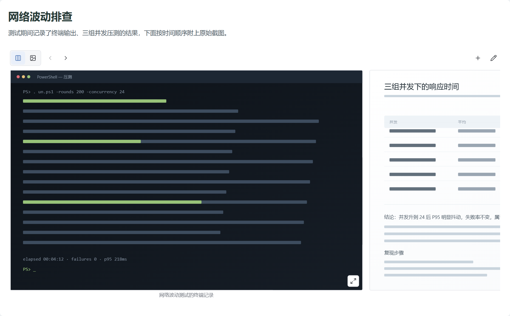
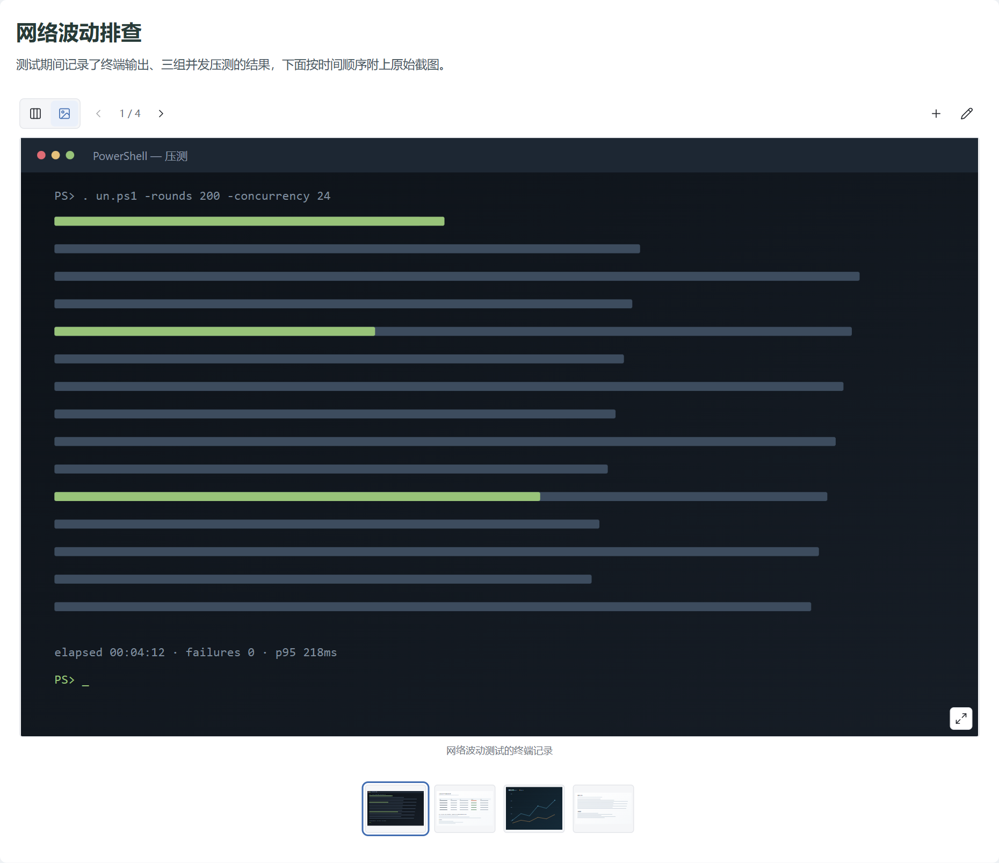
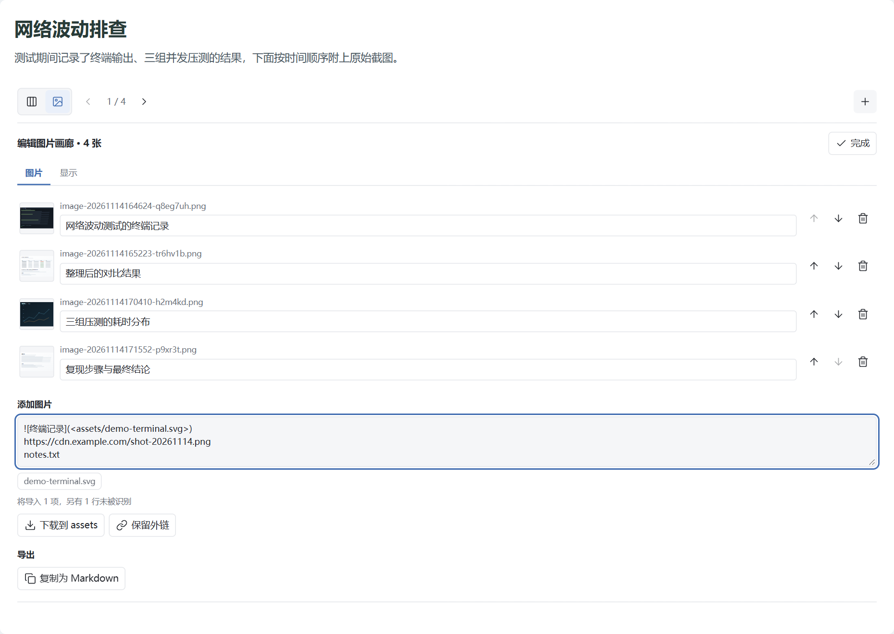

# Document Image Gallery · Inline Gallery

A simple gallery feature built on SiYuan custom blocks.

Type **`/gallery`** or **`/画廊`** in a normal document paragraph, select "Image Gallery" and press Enter. Keywords such as `图片画廊` and `hualang` are also supported, and the compact slash menu works as well.

| Main-image mode | Edit mode |
| --- | --- |
|  |  |

## Views

A new gallery opens in **main-image mode**: one full-width image with a centered thumbnail strip. **Row mode** puts every image in a single horizontally scrolling row. The first two toolbar buttons switch between them, and the choice is saved in the gallery.

Clicking an image opens the preview overlay. Besides zooming and paging, "Copy image" writes the visible image to the system clipboard as a PNG, so it can be pasted into a chat window or another editor without locating the asset file first. Workspace `assets/...` images and CORS-enabled remote images can be copied; an external link without CORS headers must be downloaded to assets first. Animated GIF/WebP sources are copied as a single still frame, because the clipboard write path only accepts PNG. Copying never modifies the block, so it also works in read-only and publish mode.

## Image Import

| Input | Behavior |
| --- | --- |
| Multi-file selection, drag & drop, clipboard screenshots/files | Saved to the global workspace `/assets/` via `/api/asset/upload` |
| SiYuan image HTML, image Markdown, `assets/...` paths | Existing paths are reused; when the clipboard contains both a local link and a bitmap, the link is reused first |
| HTML Base64 images | Converted to image files and uploaded; not written into block JSON |
| Remote image URLs | Downloaded and uploaded when pasted or when clicking "Download to assets"; failure shows a notice |
| "Keep external link" | Explicitly keeps HTTP(S) links; offline access, upstream changes, and cross-device availability depend on the source site |

The plugin maintains a `custom-data-assets-gallery-*` block attribute for every local path, so that SiYuan's asset scan recognizes the images and they are not mistaken for "unreferenced items".

## Edit Mode

Clicking "Edit" in the toolbar **replaces** the gallery with the editing panel instead of stacking controls above the preview. Edit mode has two sections:

| Section | Content |
| --- | --- |
| Images | Image list (order, captions, removal), adding images, exporting Markdown |
| Display | Size, gap and captions, with a **live preview** of the gallery below |

The gallery is hidden in the "Images" section (ordering and captions do not need the rendering), and shown below the settings in the "Display" section (size and gap need live feedback). Click "Done" to return to browsing.

## Captions

Captions sit centered directly below each image, and images without a caption **reserve the same slot**, so a caption never shifts an image:

- Row mode: a 22px single-line slot with ellipsis
- Main-image mode: a 44px two-line slot

Turning captions off removes the slots uniformly; nothing shifts per image.
