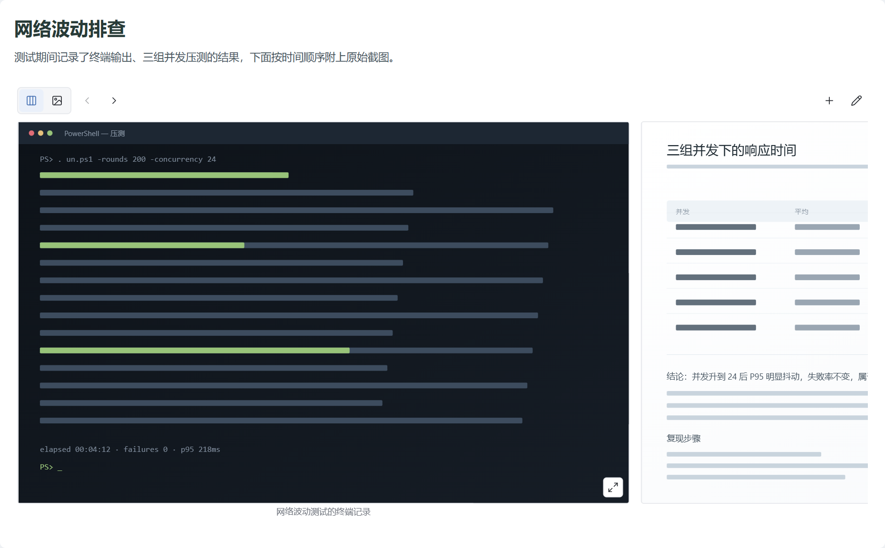
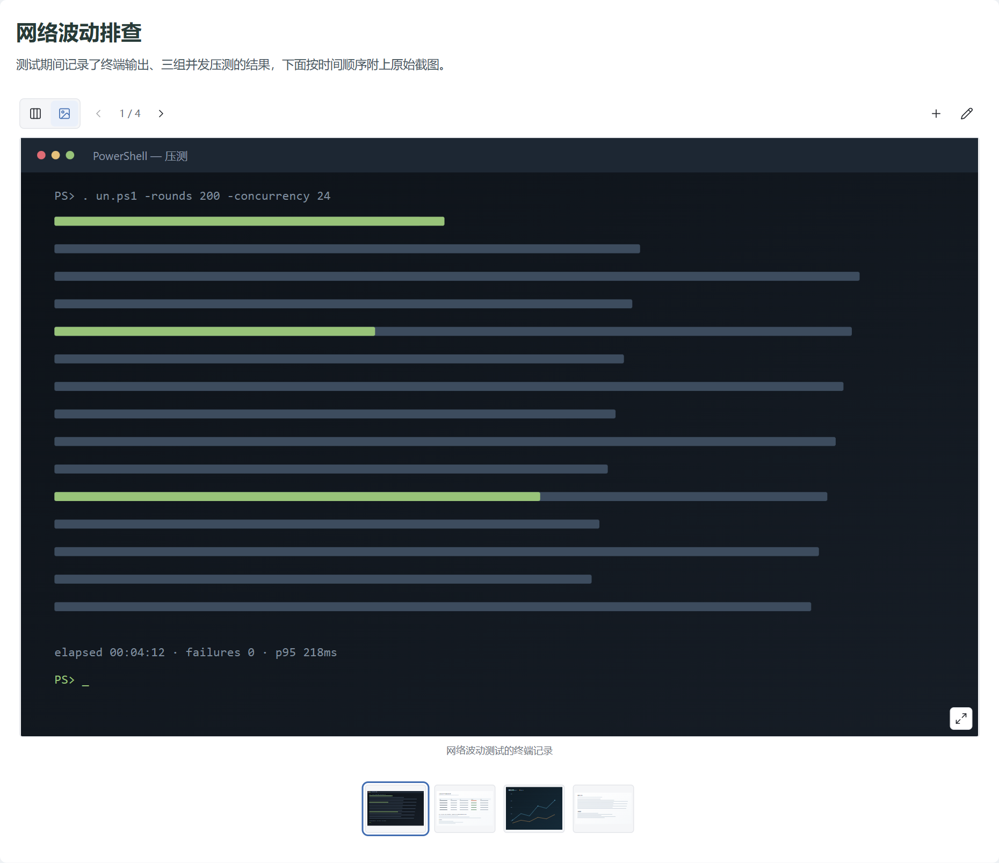
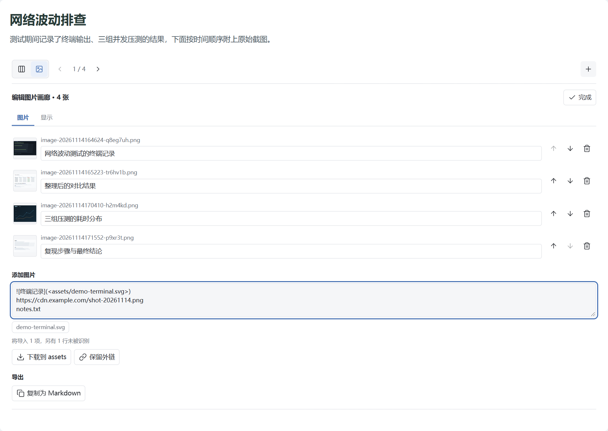

# 文档图片画廊 · Inline Gallery

基于自定义块实现的简单画廊功能。

在普通文档段落中输入 **`/gallery`** 或 **`/画廊`**，选择“图片画廊”并按 Enter。也支持 `图片画廊`、`hualang` 等关键词，精简版斜杠菜单同样可用。

| 主图模式 | 编辑模式 |
| --- | --- |
|  |  |

## 两种视图

新建画廊默认进入**主图模式**：一张满宽主图，下方是居中的缩略图条。**横排模式**把所有图片放进一条横向滚动的大图行。工具栏最前面的两个按钮切换视图，选择按画廊保存。

点击图片打开预览浮层。除了缩放和翻页，「复制图片」会把看到的这张图以 PNG 写入系统剪贴板，可以直接粘贴到聊天窗口或其他编辑器，不必先去找资源文件。工作空间 `assets/...` 图片和允许跨域的远程图片都能复制；不带 CORS 头的外链需要先「下载到 assets」。动图（GIF/WebP）复制为静态单帧，因为剪贴板写入只接受 PNG。复制不修改块内容，因此只读和发布模式同样可用。

## 图片导入

| 输入 | 行为 |
| --- | --- |
| 多文件选择、拖放、剪贴板截图/文件 | 通过 `/api/asset/upload` 保存到全局工作空间 `/assets/` |
| 思源图片 HTML、图片 Markdown、`assets/...` 路径 | 复用现有路径；剪贴板同时包含本地链接和位图时，优先复用链接 |
| HTML Base64 图片 | 转成图片文件上传，不写入块 JSON |
| 网络图片 URL | 粘贴或点击“下载到 assets”时尝试下载并上传；失败会提示 |
| “保留外链” | 明确保留 HTTP(S) 链接；离线、原站变更和跨设备可用性取决于原站 |

插件为每个本地路径维护一个 `custom-data-assets-gallery-*` 块属性，让思源资源扫描识别，避免图片被误认为“未引用项目”。

## 编辑模式

点击工具栏的“编辑”进入编辑态：图片画廊会**被编辑面板替换**，而不是在预览上方叠加一层控件。编辑态分两个分区：

| 分区 | 内容 |
| --- | --- |
| 图片 | 图片列表（排序、说明、移除）、添加图片、导出 Markdown |
| 显示 | 图片大小、间距、显示说明，以及下方跟随变化**实时预览** |

在“图片”分区中画廊是隐藏的（排序和写说明不需要看渲染结果）；在“显示”分区中画廊会显示在设置下方，因为调整大小和间距需要边看边调。点击“完成”回到浏览态。

## 图片说明

说明固定在图片正下方居中，且**没有说明的图片同样占位**，因此说明不会挤动图片位置：

- 行模式：22px 单行槽，超出省略
- 主图模式：44px 两行槽

关闭“显示说明”时槽位消失，整块高度统一减少，不会逐张错位。
